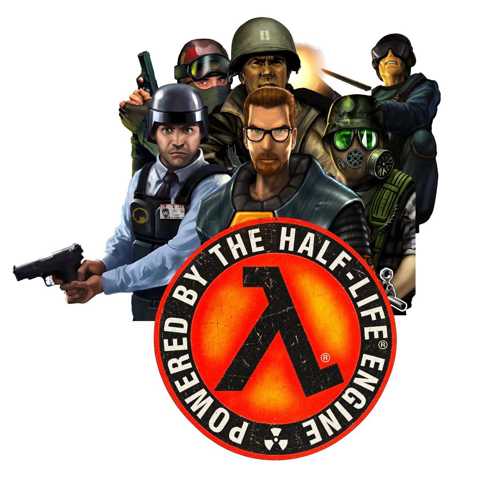

<p align="center">
  
</p>

<h1 align="center">GoldSrc-SDK</h1>

<p align="center">
  <strong>Half-Life 25th Anniversary engine, games, and Hammer 3.4 source.</strong><br>
  Visual Studio 2026 &middot; MSVC v145 &middot; Win32
</p>

GoldSrc-SDK brings together the Half-Life 25th Anniversary engine code, game client and server code, shared runtime libraries, SDK tools, and Hammer 3.4 source. The engine, games, and SDK utilities are organized into Visual Studio 2026 solutions using the MSVC v145 toolset.

## What's included

- **GoldSrc engine:** hardware and software rendering, the game launcher, and shared engine systems.
- **Game code:** client and server projects for the games listed below.
- **Servers and broadcasting:** Half-Life Dedicated Server, the dedicated engine, HLTV, and demo playback components.
- **Runtime libraries:** the filesystem, Tier0, VGUI, VGUI2, GameUI, and particle manager.
- **Hammer 3.4:** editor source in [`worldcraft/`](worldcraft/).
- **SDK utilities:** map compilation, model compilation and viewing, sprite generation, WAD tools, and other development utilities.

## Included games

| Game | Runtime directory |
| --- | --- |
| Half-Life | `valve` |
| Half-Life: Opposing Force | `gearbox` |
| Half-Life: Blue Shift | `bshift` |
| Counter-Strike | `cstrike` |
| Counter-Strike: Condition Zero | `czero` |
| Counter-Strike: Condition Zero — Deleted Scenes | `czeror` |
| Team Fortress Classic | `tfc` |
| Day of Defeat | `dod` |
| Deathmatch Classic | `dmc` |
| Ricochet | `ricochet` |

## Building

### Requirements

- **Visual Studio 2026** with the **Desktop development with C++** workload.
- **MSVC v145** C++ build tools.
- **Windows SDK 10.0.26100.0**.
- The dependency headers and libraries supplied under [`external/`](external/) and [`lib/`](lib/).

The build targets **Win32 (x86)**, with **Debug** and **Release** configurations.

### Visual Studio

1. Open [`projects/vs2026/projects.sln`](projects/vs2026/projects.sln).
2. Select **Release** or **Debug**, and **Win32** as the platform.
3. Build the desired projects, or build the solution after resolving the checkout note below.
4. Open [`projects/vs2026/utils.sln`](projects/vs2026/utils.sln) to build the SDK utilities.

### Command line

Run these commands from the repository root in the **Developer Command Prompt for VS 2026**:

```bat
msbuild projects\vs2026\projects.sln /m /p:Configuration=Release /p:Platform=Win32
msbuild projects\vs2026\utils.sln /m /p:Configuration=Release /p:Platform=Win32
```

Use `/p:Configuration=Debug` for a debug build.

## Build output

Runtime and game binaries are placed under:

```text
bin/Win32/Release/
bin/Win32/Debug/
```

SDK utility executables are placed in the corresponding `utils/` subdirectory. Intermediate build files are kept under `bin/obj/`.

| Component | Output |
| --- | --- |
| Game launcher | `hl.exe` |
| Dedicated server launcher | `hlds.exe` |
| HLTV launcher | `hltv.exe` |
| Hardware-rendered engine | `hw.dll` |
| Software-rendered engine | `sw.dll` |
| Dedicated server engine | `swds.dll` |
| HLTV and demo support | `Core.dll`, `DemoPlayer.dll`, `proxy.dll` |
| Filesystem | `filesystem_stdio.dll` |
| Shared runtime and UI | `tier0.dll`, `vgui.dll`, `vgui2.dll` |
| Game UI and effects | `valve/cl_dlls/GameUI.dll`, `valve/cl_dlls/particleman.dll` |
| Game client/server DLLs | The game directories listed above, under `cl_dlls/` and `dlls/` |

## Source layout

| Path | Contents |
| --- | --- |
| [`engine/`](engine/) | Engine implementation |
| [`launcher/`](launcher/) | Game launcher |
| [`dedicated/`](dedicated/) | Dedicated server launcher |
| [`HLTV/`](HLTV/) | HLTV, proxy, core, and demo playback code |
| [`cl_dll/`](cl_dll/), [`dlls/`](dlls/) | Half-Life client and server code |
| [`common/`](common/), [`public/`](public/), [`game_shared/`](game_shared/), [`pm_shared/`](pm_shared/) | Shared interfaces, game code, and movement code |
| [`filesystem/`](filesystem/), [`tier0/`](tier0/), [`vgui2/`](vgui2/), [`GameUI/`](GameUI/) | Filesystem, runtime support, and UI components |
| [`worldcraft/`](worldcraft/) | Hammer 3.4 editor source |
| [`utils/`](utils/) | SDK utilities and VGUI source |
| [`projects/vs2026/`](projects/vs2026/) | Visual Studio solutions, project files, and shared build settings |
| [`external/`](external/), [`lib/`](lib/) | Dependency headers and libraries |

Counter-Strike and Condition Zero share source through the projects under `projects/vs2026/`; `czero` is a runtime output directory rather than a separate top-level source folder.

## Credits

Original engine and game technology by Valve and the respective game developers, including Gearbox Software, Ritual Entertainment, and the original mod teams.

GoldSrc-SDK is a community project. Half-Life, Counter-Strike, and other game names and trademarks belong to their respective owners. Preserve the copyright and license notices supplied with each source component and dependency.
